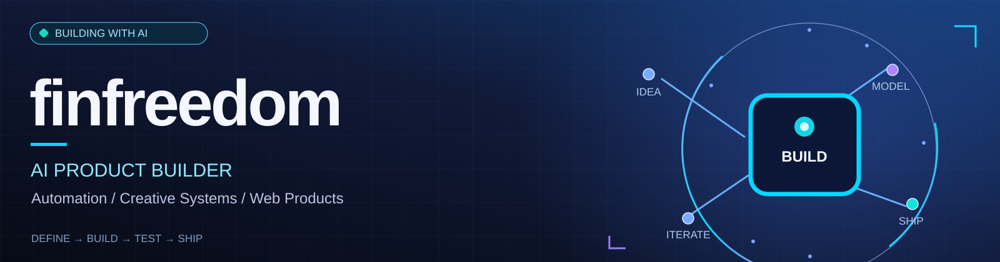
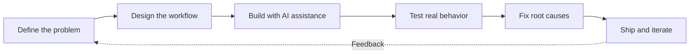

 

**I turn product ideas into working systems — from architecture and prototypes to real-world iteration.**

I work with AI-assisted development, automation pipelines, creative tooling, and practical web products.

---

## ⚡ What I build

My work sits at the intersection of **product design, AI-assisted implementation, APIs, automation, and media production**. I use **Claude Code** as my primary AI development environment: I define the behavior, investigate failures, evaluate outcomes, and keep iterating until the system solves the intended problem.

A strong product is more than a prompt or a demo. It needs **useful workflows, validation, recovery from failures, cost awareness, and a clear user experience**.

## 🛠️ Tools & technologies

  

---

## 🚀 Featured projects

<table>
  <tr>
    <td width="50%" valign="top">
      <h3>🧠 Money Mind Studio</h3>
      
<strong>AI-powered content production pipeline</strong>

      
A multi-stage system for knowledge retrieval, structured generation, validation, voice, rendering, Telegram approval, and publishing. Built with resumable state, error classification, and cost-aware execution.

      
<code>TypeScript</code> <code>Node.js</code> <code>Claude</code> <code>OpenAI</code> <code>SQLite</code> <code>Remotion</code>

      
    </td>
    <td width="50%" valign="top">
      <h3>🎬 Brand Collapse Studio</h3>
      
<strong>Documentary-video production automation</strong>

      
A Python workflow connecting narration, scene timing, stock-footage retrieval, visual checks, graphics, and FFmpeg rendering. Developed through repeated render-review-improve cycles.

      
<code>Python</code> <code>OpenAI TTS</code> <code>FFmpeg</code> <code>Pexels API</code> <code>Pillow</code>

      
    </td>
  </tr>
  <tr>
    <td width="50%" valign="top">
      <h3>🚗 China Auto Import</h3>
      
<strong>Commercial web product for an active business</strong>

      
A conversion-focused product addressing international car-buying uncertainty with transparent cost estimates, contextual Telegram inquiries, search visibility, analytics, and a trust-centered customer journey.

      
<code>Astro</code> <code>React</code> <code>TypeScript</code> <code>SSR</code> <code>Vercel</code>

      
    </td>
    <td width="50%" valign="top">
      <h3>⛓️ Portaldot ink! Toolchain</h3>
      
<strong>Verified smart-contract compatibility research</strong>

      
A technical guide to building and deploying ink! contracts on Portaldot's legacy runtime, with a comparison to V3. Documents tested toolchain versions, deployment constraints, and reproducible solutions.

      
<code>Rust</code> <code>ink!</code> <code>Substrate</code> <code>Polkadot.js</code>

      
    </td>
  </tr>
</table>

---

## 🧪 In the lab

Ongoing private projects and production systems. More public case studies may follow as they become ready to share.

<table>
  <tr>
    <td width="33%" valign="top">
      <h3>🧭 AI Office</h3>
      
Designing a personal AI coordination system with multiple models, persistent context, structured tasks, and cost controls.

      Architecture and evaluation in progress
    </td>
    <td width="33%" valign="top">
      <h3>🕹️ Pixel Stage</h3>
      
Building a timing-driven pixel-art scene engine for animated storytelling and reusable media production.

      Private creative tooling
    </td>
    <td width="33%" valign="top">
      <h3>🐾 Facts Shorts</h3>
      
Developing repeatable workflows for research-backed animal videos, voice casting, footage selection, and rendering.

      Private content production
    </td>
  </tr>
</table>

---

## 📊 GitHub activity

 

 

Statistics rely on external services and may reflect only visible GitHub activity.

---

## 🔁 How I work

I use AI tools to accelerate implementation, but I remain responsible for **requirements, product decisions, acceptance criteria, testing, and iteration**. My focus is not to generate code for its own sake — it's to get useful systems working.

Some production repositories remain private because they contain proprietary processes, business details, or unpublished work. Their public case studies are intentionally scoped to what can be shared safely.

---

**Build useful things. Verify the results. Keep improving.**

