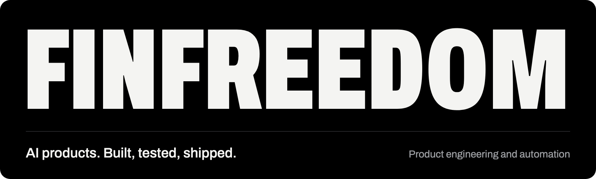

 

I design and build AI products and the systems that run them, from the first idea to a tested release.

<picture><source media="(prefers-color-scheme: dark)" srcset="https://cdn.simpleicons.org/claude/ffffff"></picture>
<picture><source media="(prefers-color-scheme: dark)" srcset="assets/chatgpt-ffffff.svg"></picture>
<picture><source media="(prefers-color-scheme: dark)" srcset="https://cdn.simpleicons.org/googlegemini/ffffff"></picture>
<picture><source media="(prefers-color-scheme: dark)" srcset="assets/openclaw-ffffff.svg"></picture>
<picture><source media="(prefers-color-scheme: dark)" srcset="https://cdn.simpleicons.org/qwen/ffffff"></picture>
<picture><source media="(prefers-color-scheme: dark)" srcset="https://cdn.simpleicons.org/huggingface/ffffff"></picture>
<picture><source media="(prefers-color-scheme: dark)" srcset="https://cdn.simpleicons.org/elevenlabs/ffffff"></picture>
  
<picture><source media="(prefers-color-scheme: dark)" srcset="https://cdn.simpleicons.org/python/ffffff"></picture>
<picture><source media="(prefers-color-scheme: dark)" srcset="https://cdn.simpleicons.org/typescript/ffffff"></picture>
<picture><source media="(prefers-color-scheme: dark)" srcset="https://cdn.simpleicons.org/javascript/ffffff"></picture>
<picture><source media="(prefers-color-scheme: dark)" srcset="https://cdn.simpleicons.org/nodedotjs/ffffff"></picture>
<picture><source media="(prefers-color-scheme: dark)" srcset="https://cdn.simpleicons.org/react/ffffff"></picture>
<picture><source media="(prefers-color-scheme: dark)" srcset="https://cdn.simpleicons.org/astro/ffffff"></picture>
<picture><source media="(prefers-color-scheme: dark)" srcset="https://cdn.simpleicons.org/threedotjs/ffffff"></picture>
  
<picture><source media="(prefers-color-scheme: dark)" srcset="https://cdn.simpleicons.org/ffmpeg/ffffff"></picture>
<picture><source media="(prefers-color-scheme: dark)" srcset="https://cdn.simpleicons.org/pytorch/ffffff"></picture>
<picture><source media="(prefers-color-scheme: dark)" srcset="https://cdn.simpleicons.org/sqlite/ffffff"></picture>
<picture><source media="(prefers-color-scheme: dark)" srcset="https://cdn.simpleicons.org/kaggle/ffffff"></picture>
<picture><source media="(prefers-color-scheme: dark)" srcset="https://cdn.simpleicons.org/git/ffffff"></picture>
<picture><source media="(prefers-color-scheme: dark)" srcset="https://cdn.simpleicons.org/github/ffffff"></picture>
<picture><source media="(prefers-color-scheme: dark)" srcset="https://cdn.simpleicons.org/vercel/ffffff"></picture>

