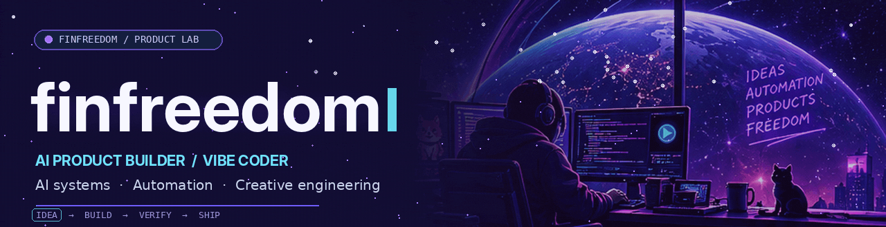
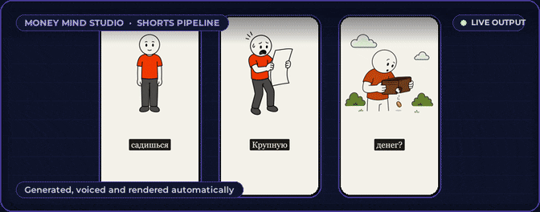
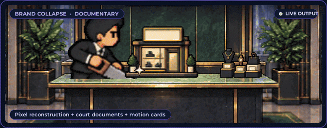
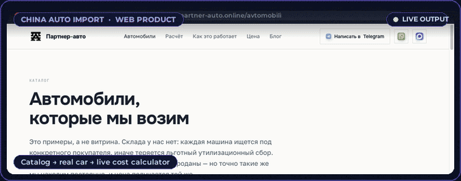
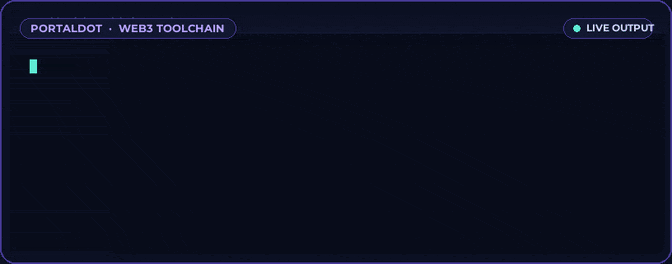
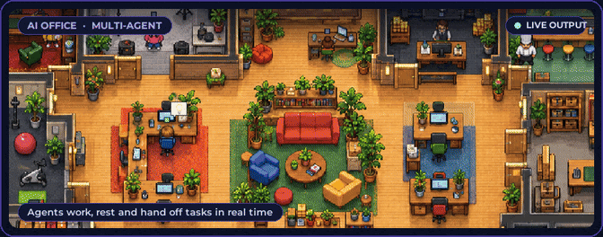
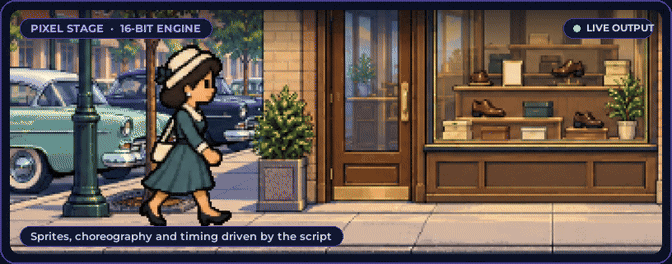
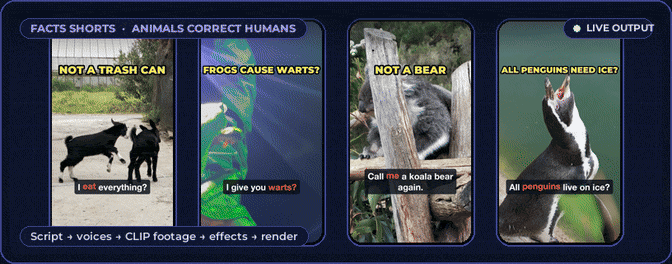
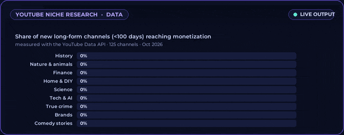

 

 

**I build practical AI products, automated workflows and creative systems — from idea to tested output.**

Product thinking · AI-assisted engineering · Real-world iteration

## ✦ Selected work

<table>
<tr><td width="50%" valign="top">

 <b>Money Mind Studio</b> · AI CONTENT 
Structured generation, validation, voice, rendering and Telegram approvals. Designed for recoverable, cost-aware production. 
<a href="https://github.com/finfreedom/money-mind-studio-showcase">Explore case study ↗</a>
</td><td width="50%" valign="top">

 <b>Brand Collapse Studio</b> · CREATIVE ENGINEERING 
Documentary-video pipeline connecting narration, scene timing, media search, visual checks and FFmpeg rendering. 
<a href="https://github.com/finfreedom/brand-collapse-studio-showcase">Explore case study ↗</a>
</td></tr>
<tr><td width="50%" valign="top">

 <b>China Auto Import</b> · WEB PRODUCT 
Commercial website with cost estimation, contextual inquiries, SEO and analytics, built around customer trust. 
<a href="https://github.com/finfreedom/china-auto-import-showcase">Explore case study ↗</a>
</td><td width="50%" valign="top">

 <b>Portaldot ink! Toolchain</b> · WEB3 RESEARCH 
A verified legacy ink! build/deploy recipe, plus toolchain compatibility notes for the V3 testnet. 
<a href="https://github.com/finfreedom/portaldot-ink-toolchain">Explore public repository ↗</a>
</td></tr>
</table>

## ◈ In the lab

<table>
<tr>
<td width="50%" valign="top"> <b>AI Office</b> · ARCHITECTURE / DEVELOPMENT Multi-model personal AI system for coordinating tasks, approvals, memory and auditing. Architecture and orchestration work in progress.</td>
<td width="50%" valign="top"> <b>Pixel Stage</b> · PIXEL VIDEO ENGINE A timing-driven 16-bit visual storytelling engine with scene choreography, sprites and synthesized effects.</td>
</tr>
<tr>
<td width="50%" valign="top"> <b>Facts Shorts</b> · MEDIA PIPELINE Research-backed animal content with local voice generation, CLIP footage selection and automated editing.</td>
<td width="50%" valign="top"> <b>YouTube Niche Research</b> · DATA TOOLING Research toolkit that compares emerging niches and tracks trends using the YouTube Data API.</td>
</tr>
</table>

Every card is a live recording of real output from the project. Private projects are shown through public-safe output, not source-code releases.

## ◇ By the numbers

## ⌘ Tools & technologies

**Core development**

**AI models & creative tools**

**Automation, APIs & local tooling**

automation / APIs · MCP · SQLite · FFmpeg · YouTube Data API · Pexels · Pixabay · Freesound · Pillow · NumPy · PyTorch · MLX · CLIP · faster-whisper · GitHub CLI · uv · Vercel

## ↗ How I work

**Define the problem → build the smallest useful version → inspect real output → fix root causes → iterate.**

I use AI as an implementation accelerator while retaining responsibility for product choices, testing and acceptance. I prefer reusable systems, documented trade-offs, source-backed research and licensed media.

<b>📊 GitHub activity (expand)</b>

External image providers may not always load; statistics reflect publicly accessible activity.

Built as a portfolio of real work. Public case studies ↗ <a href="https://github.com/finfreedom?tab=repositories">All repositories</a>

